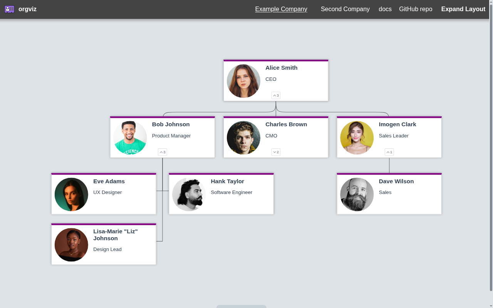
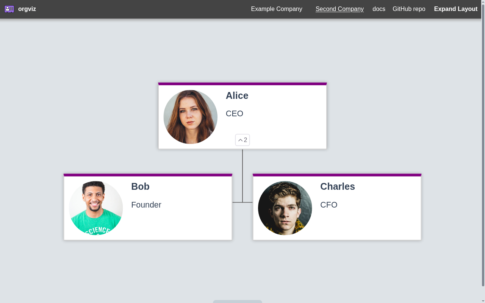
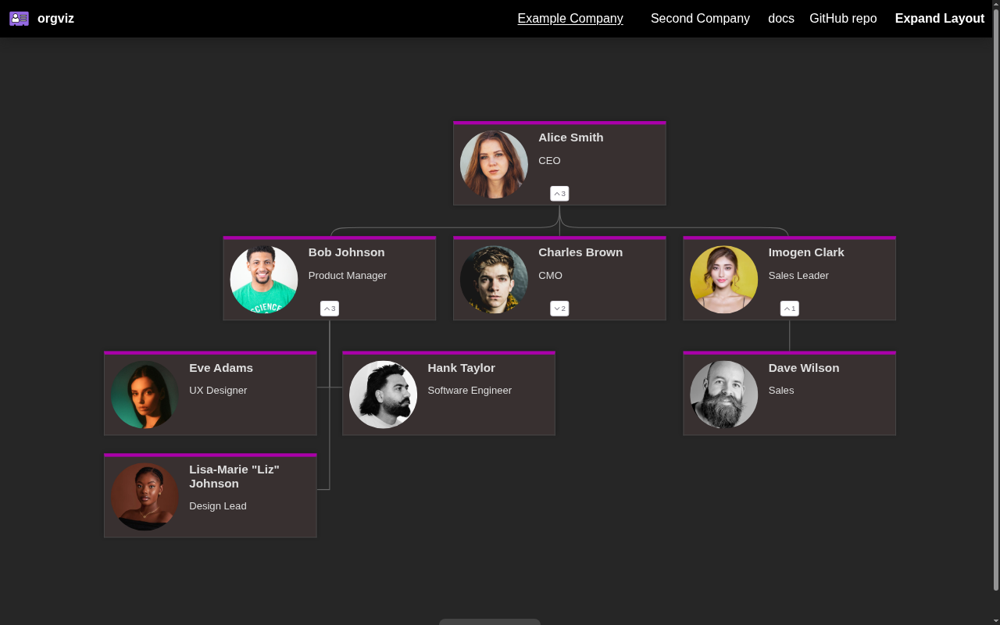

  
  <h1>orgviz</h1>

  Visualize collections of people.

orgviz v2 renders to a web interface.
orgviz v1 renders to a static image, such as a PNG or SVG.

## Screenshots

### Org chart

An interactive org chart for Example Company, with names, job titles and avatars, so reporting lines are visible at a glance.

### Switch charts

Switch between organisation files from the header, so one orgviz instance can show several teams or companies.

### Dark mode

The same org chart in a dark colour scheme that follows the browser preference, easier on the eyes in low light.

Screenshots use fictional test data and are regenerated with `make screenshots`
(see [`var/marketing/screenshots`](var/marketing/screenshots/README.md)).

## Getting started

orgviz is installed as a docker container, and run with a .yml organization file. Avatars are stored in the "avatars" directory in your config docker volume.

To get started, see https://jamesread.github.io/orgviz/ for the documentation.

## Credits

Example avatars all from plexels.com.
